<p align="center">
  
</p>

<h1 align="center">Engram</h1>

<p align="center">
  <b>A home for your coding agents on Windows.</b><br>
  Run several omp sessions at once, read them as chats, let one of them run the others,<br>
  and know at a glance which one needs you. Close the window: the work goes on.
</p>

<p align="center">
  <a href="https://github.com/TIMOYOOO/engram-releases/releases/latest"></a>
  
</p>

<p align="center">
  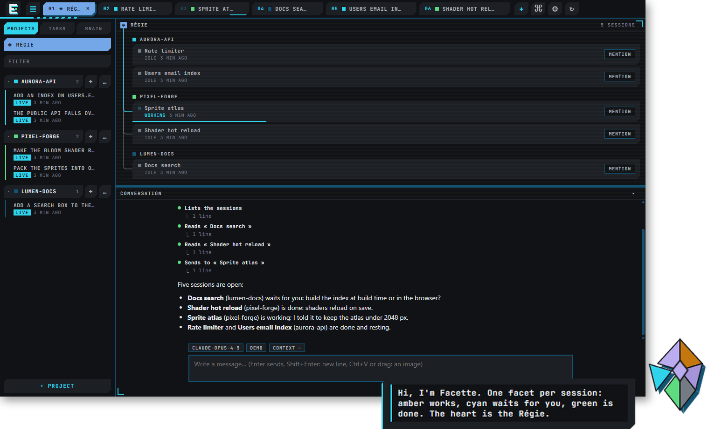
</p>

## Why Engram

Coding agents work for minutes, sometimes hours, and the useful way to use them is several at a time: one fixes a
bug while another writes the docs and a third waits for your answer. A terminal window is a poor place for that.
Engram is built around it:

- **They keep running.** A small background daemon holds every shell and every agent; the window (the *Deck*) is
  only a view on them. Close it, come back tomorrow: each tab is where you left it.
- **You read them, not their terminal.** An omp conversation shows as a chat: one line per tool call, edits with
  their diff, questions as cards you answer with a click.
- **You stay on top of many.** The *Régie* is a conversation that runs the others: ask it who is waiting, what one
  of them found, or to open a new one. *Facette*, a small geode on your desktop, shows every session's state even
  when the Deck is closed.
- **They remember.** A built-in *brain*, a vault of markdown notes compatible with Obsidian, feeds each new
  conversation with what matters and keeps what they learn.

Without omp, Engram is still a terminal whose sessions outlive its window: dev servers, test watchers and long jobs
keep running in the background.

## Features

### Facette, on your desktop

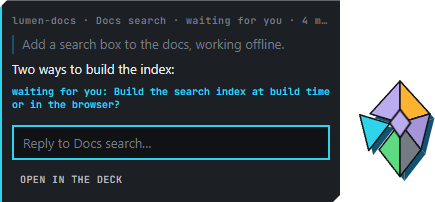

A small geode that stays above your windows, even with the Deck closed. Each live omp session holds one of its six
facets (colors of the Dark style; each style has its own):

- **grey** is a free facet, **lavender** a session at rest;
- it beats **amber** while its session works, detaches in **cyan** and pings when it waits for you, turns **red**
  and shakes on an error;
- it turns **green** when an answer is done, and stays green until you read it, in the Deck or from Facette.

Its **heart**, where the facets meet, is the Régie. Hover a facet for *project · session · state · since when*. Click
it and the conversation opens beside the geode, shortened to its last turns, with a line to answer it; double-click
it and the Deck opens on that conversation. Click the heart, or press `Ctrl+Alt+Space` from anywhere, to talk to the
Régie.

A session that waits for you or fails says so in a line over the geode, with a soft sound: no Windows notification to
dismiss. Drop a file or some text on the geode and it lands in the brain's inbox. Facette steps aside when a game or
a video goes full screen.

### The Régie: one conversation that runs the others

The picture at the top is the Régie's tab: a map of your omp sessions grouped by project, and its conversation docked
below. Ask it in plain words. It lists the sessions, reads their last answers, writes to them (the message arrives as
`[Régie] …`, queued if the session is at work), opens new ones in a project's folder with a first instruction, waits
until they are done and sums up what they said. A line on the map ties it to each session it worked with.

Whatever it writes into another session from a question asked in Facette waits for your *Send* or *Cancel* first. It
closes a session only when asked, never one at work, and remembers its own conversation from one opening to the next.

### A Chat view for omp

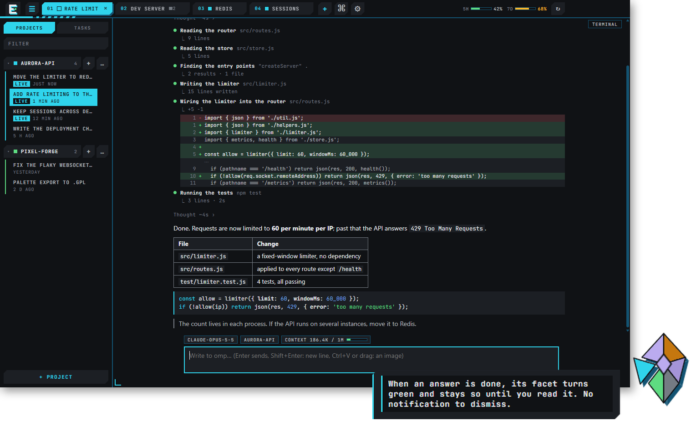

Start omp in a tab and the conversation comes to the front as a chat, with a *Terminal* tab beside it for the real
thing:

- your messages in bubbles, the reasoning folded into one line;
- **each tool call on one line**: what was done and on what, then what it came to (`9 lines`, `code 1`,
  `2 results · 1 file`); a click unfolds the output;
- **edits with their diff**, removed lines in red, added in green, with line numbers;
- tables, links, quotes, code blocks colored by language with a copy button, and **pictures**: an SVG block drawn in
  the colors of your style, a picture whose path an answer names shown under its paragraph;
- **paths in answers are links**: `src/app.js:12` opens the file in the editor at that line;
- **quote what you answer**: select a sentence in an answer, or lines in the editor, and *↩ Quote* drops it into your
  message as a chip that brings you back to its source;
- **pictures in your messages**: paste one (`Ctrl+V`) or drop it on the view;
- a **context gauge** under the conversation: its size against the model's context window (`186.4k / 1M`), green,
  then amber, then red as it fills.

omp itself is untouched: Engram follows the conversation file it writes, and installs omp for you the first time if
it is missing.

### Answer omp's questions with a click

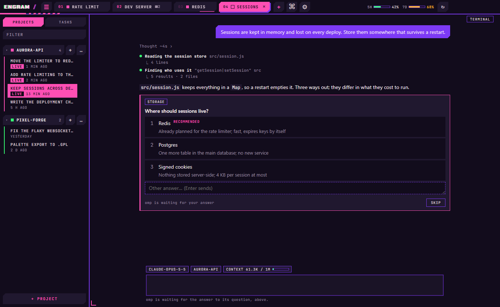

When omp asks you something, the question and its options appear as a card in the conversation. One click answers;
several questions, multiple choices or a typed answer are gathered, then sent together. The answer goes into omp's own
dialog, so the terminal stays in sync.

### See the work while it happens

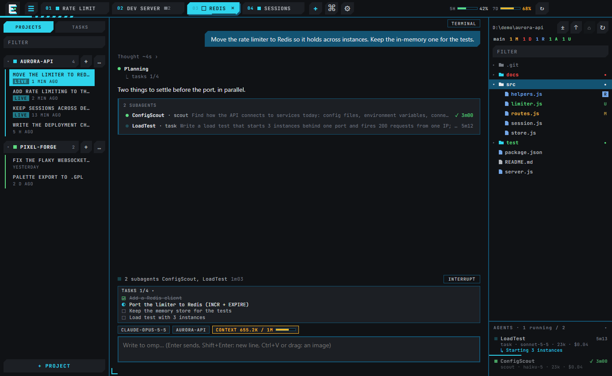

- A **status line** says what omp is doing and for how long, with an *Interrupt* button.
- omp's **task list stays pinned** above the input box while tasks remain.
- The **subagents** it starts show as a card in the conversation, and in the **Agents panel** under the file tree:
  running ones first, with their kind, model, context, cost, time and what they are doing right now. A click opens an
  agent's log.

### A brain for your agents

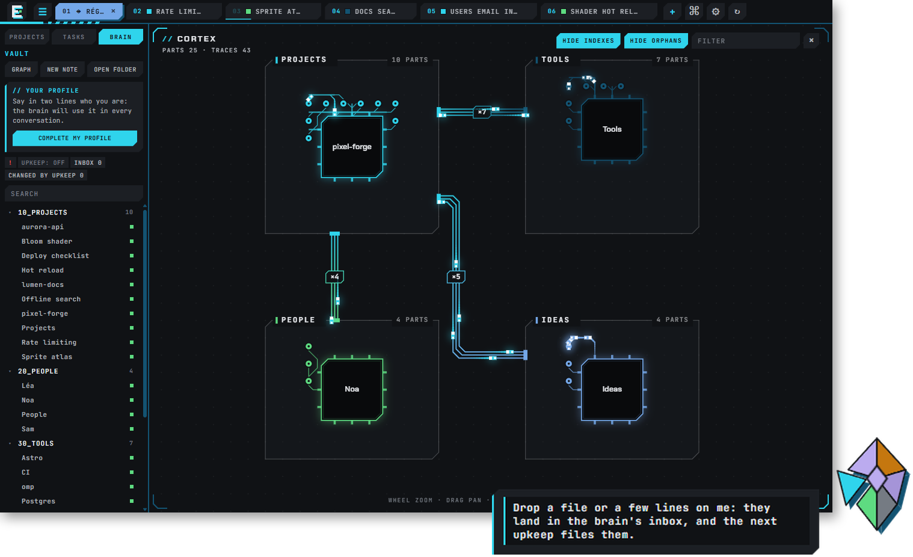

The *Brain* tab holds a vault of markdown notes, compatible with Obsidian: a folder tree, search, the links of the
note you read, and a graph drawn as a circuit board (domains as zones, notes as chips, links as traces). Notes open
in the editor with a live preview.

Point it at your own Obsidian vault, or let Engram make one. A guided start asks where it lives, writes your profile
in a few questions, and lets you choose what it may do, each with its cost:

- new omp conversations start with your profile and the top of its index;
- at each message, omp gets a few pointers to the notes that match it;
- finished omp and Claude Code conversations are captured into its inbox;
- a daily upkeep, given to omp, files the inbox into pages. A strip shows what it changed, and one click puts every
  page back as it was. Each note keeps its earlier texts for 30 days.

### Your Claude subscription at a glance

The bar shows the **5-hour and 7-day windows** of your Claude subscription, as omp last measured them, each with its
gauge. Hover one to see when it resets.

### Projects and conversations

The left panel groups your folders as projects, with every omp conversation under its project, newest first. One click
resumes a conversation in a new tab, or jumps to the tab that already runs it. Rename, filter and delete from there.

### Tabs and split panes

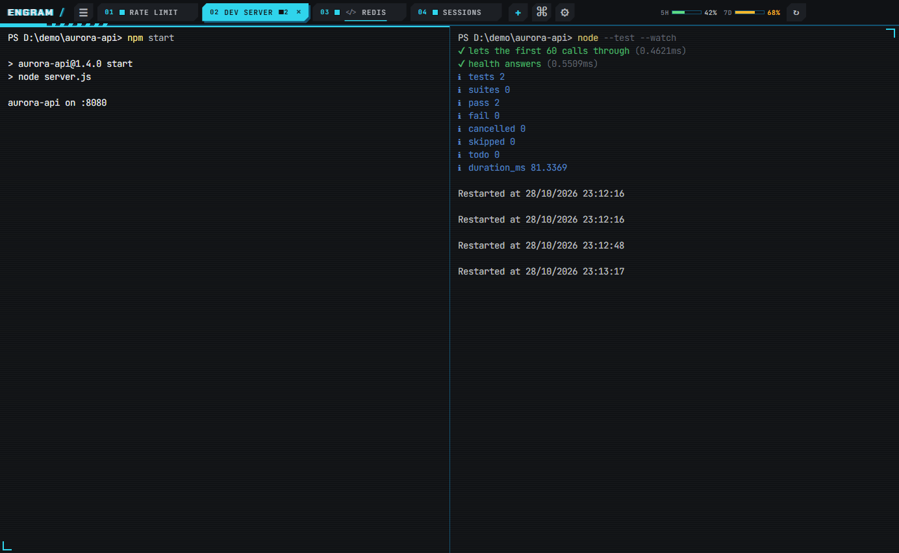

Tabs, panes side by side or stacked (`Alt+Shift+D`), zoom on one pane, a floating pane that stays in sight from every
tab, search in the scrollback (`Ctrl+Shift+F`), and a notice when a long job ends in a tab you are not looking at.

### Files, Git and a code editor

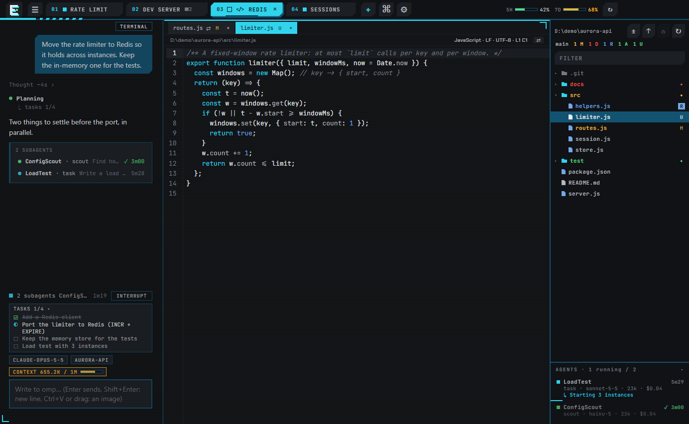

The *Files* panel (`Ctrl+Shift+E`) follows the folder of the terminal you are in, and the disk: a file omp writes or
deletes shows at once, and lights up for a moment. Each changed file wears its **Git mark** (`U` untracked, `A` added,
`M` modified, `D` deleted, `R` renamed), folders holding changes wear a dot, and the branch with its counts stands
under the bar. Click a file and it opens next to your terminals, with its own inner tabs, syntax highlighting, search
and replace.

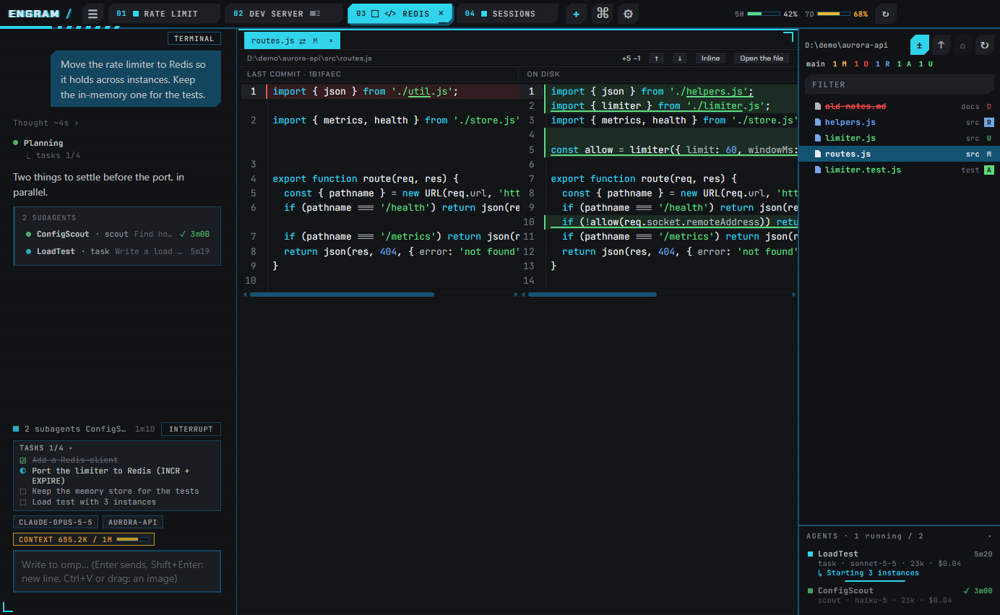

The **Changes** view (`±`) lists the changed files alone. Click one to **compare it with the last commit**, side by
side or in one column, unchanged stretches folded, `F7` to jump from one change to the next. It follows the file live.

### Command palette

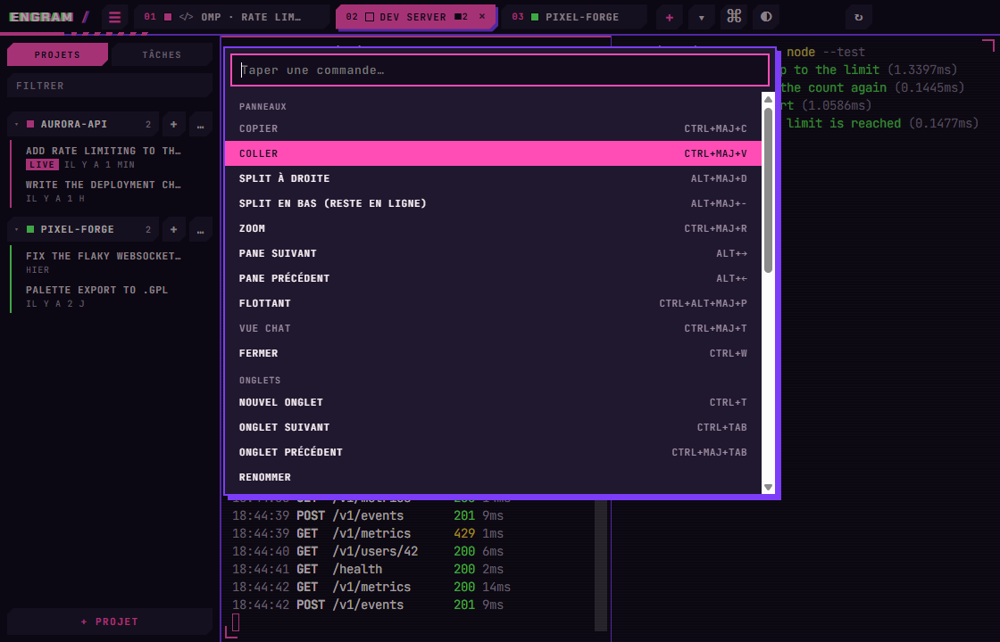

Every action with its shortcut, one fuzzy search away: `Ctrl+Shift+P`.

### Recurring tasks

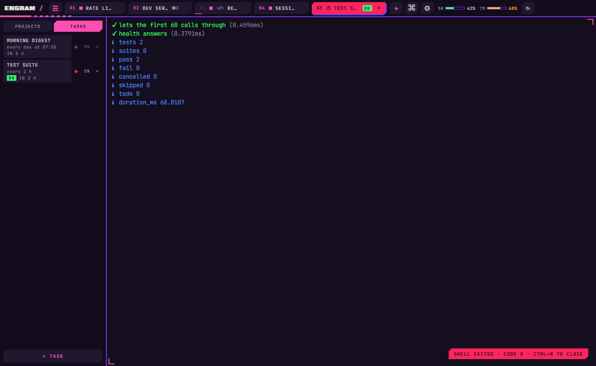

Schedule a command or an omp prompt (`07:00`, every `2h`…). Each run gets a tab of its own with its output and exit
code. A run missed while the PC was off happens once when Engram comes back.

### Made for agents too

Every shell started by Engram knows the `engram` command, so an agent working in it can open a pane beside its own,
read what another pane shows, and close it, with no one at the window:

```
engram split --title api -- npm run dev
engram read <pane> --lines 40
engram list
```

### Settings, in English or French

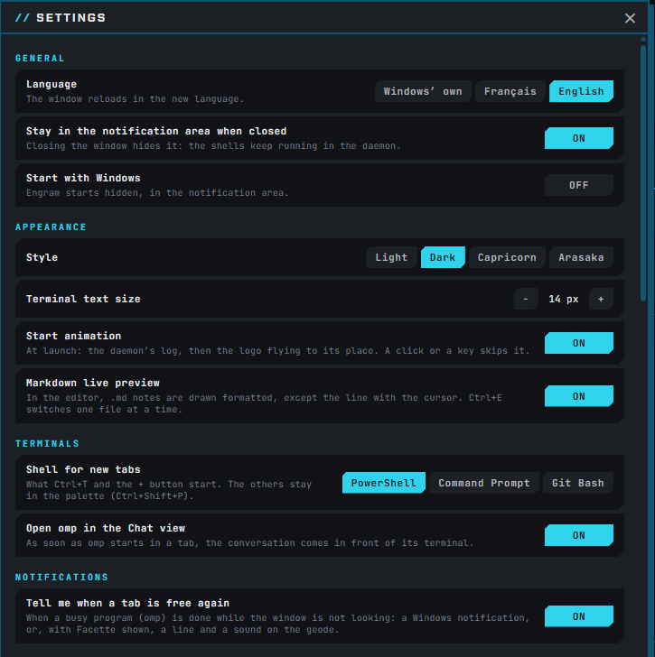

Everything in one panel (`Ctrl+,` or ⚙ in the bar): language, staying in the notification area, starting with Windows,
style, terminal text size, the shell of new tabs, omp in the Chat view at once, notices, Facette (its shortcut, full
screen, sounds), the brain, and omp's own model and tool approval. The interface speaks English or French and follows
Windows' language by default.

### Four styles

Dark, shown everywhere above, and Light are the sober ones; Capricorn and Arasaka are the showier ones.

| Dark | Light |
|---|---|
| 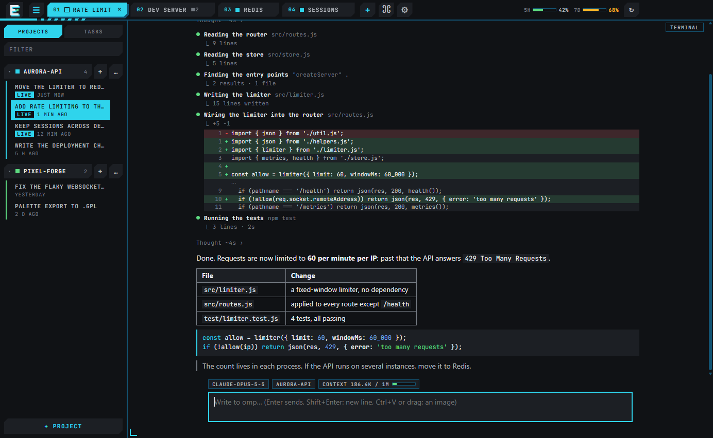 | 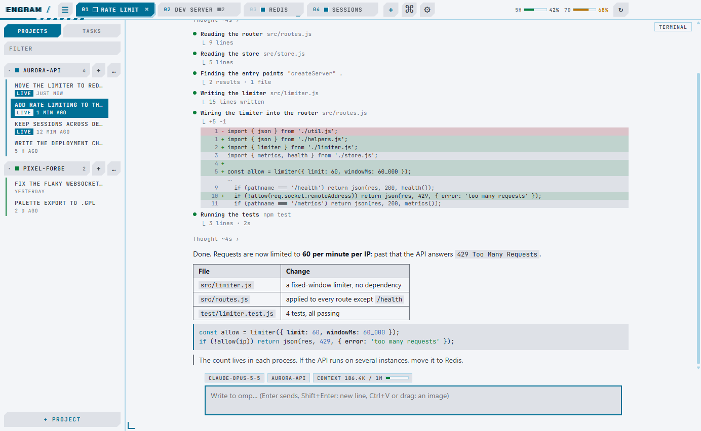 |
| **Capricorn** | **Arasaka** |
| 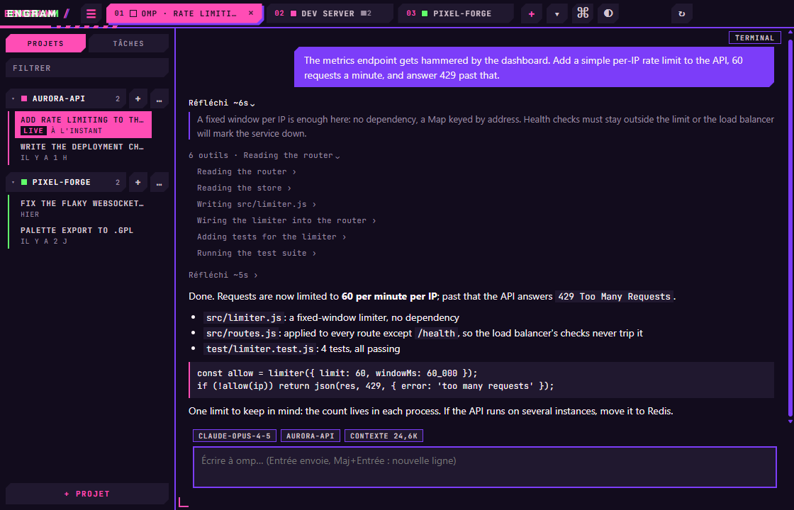 | 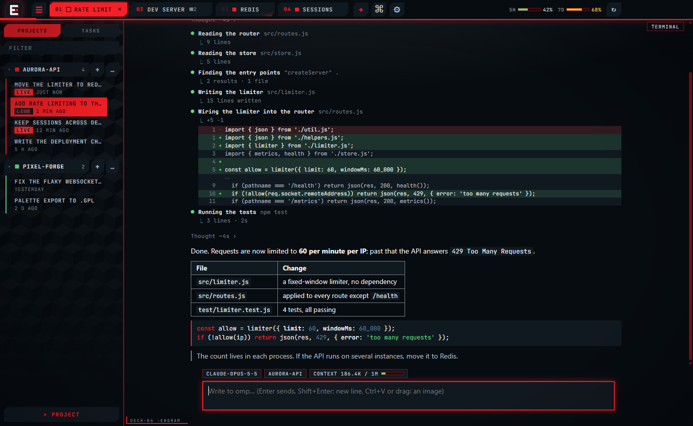 |

Pick one in the settings or the command palette; it applies at once, terminal colors and notification-area icon
included.

## Download

**[Get the latest version](https://github.com/TIMOYOOO/engram-releases/releases/latest)** (Windows 10 or 11, 64-bit)

Download `Engram-Setup-<version>.exe` and run it. It installs for the current user only, with no administrator rights,
and adds a Desktop and a Start menu shortcut.

The installer is not code-signed, so Windows SmartScreen may warn you the first time: choose *More info*, then
*Run anyway*.

omp is optional: without it, Engram is a plain persistent terminal.

## Updates

Engram updates itself. The button at the top right of the window shows when a new version is available
(`↑ <version>`), downloads it on a click, then installs it on a second click. Installing stops the background daemon,
so any running shell is closed. The app asks first if one is open.

## Safety

- The daemon listens on `127.0.0.1` only, and refuses anything sent by a web page.
- Every connection must give a token stored in your user folder, or it is shut out.
- A client never names a program to run: it picks a shell from a fixed list (PowerShell, cmd, Git Bash).

## License

Engram is free to use, at home or at work, but it is not open source: see [LICENSE.md](LICENSE.md). In short, you may
use it on as many computers as you like; you may not resell or redistribute it, nor take it apart; it comes as is,
with no warranty.

## About

This repository only holds the installers and the release notes. The source code is private.
